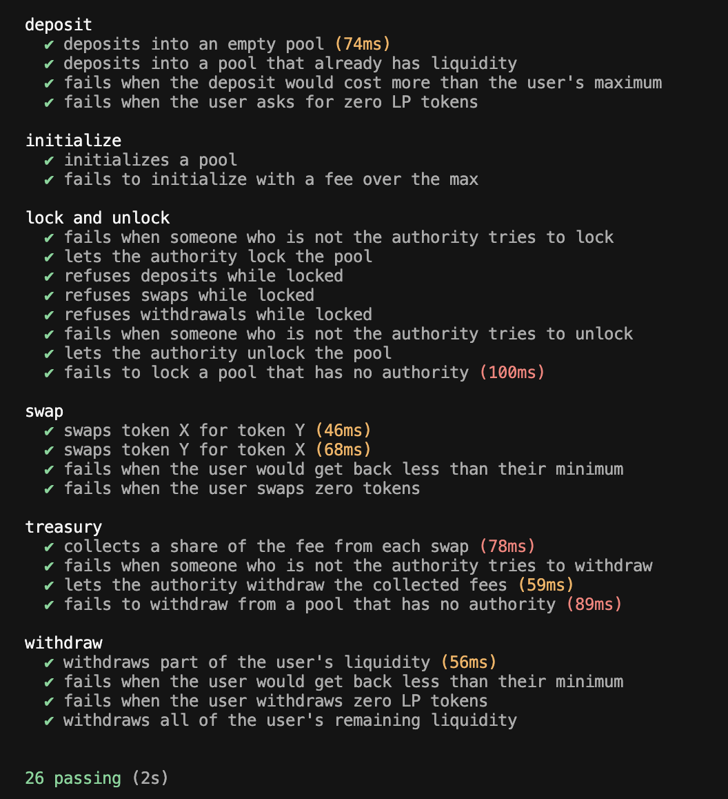

# Week 3 Assignment: Automated Market Makers

The goal of this assignment is to:

1. Write the AMM program with all instructions (initialize, deposit, swap, withdraw, lock, unlock).
2. Add protocol fees and a treasury account that collects them.
3. Write tests covering all the instructions using TypeScript and Mocha.

And optionally:

4. Implement the constant product (CPMM) maths without using the `constant-product-curve` library.
5. Reason about how to mitigate downtime in DeFi applications.

The program lives in one Anchor workspace: `programs/amm`. It follows the structure of the tutor's reference AMM, updated to current Anchor patterns.

## Code Documentation

- Anchor: https://www.anchor-lang.com/docs
- Anchor TypeScript client: https://www.anchor-lang.com/docs/clients/typescript
- Program Derived Addresses: https://solana.com/docs/core/pda
- Cross Program Invocation: https://solana.com/docs/core/cpi
- Tokens on Solana: https://solana.com/docs/tokens
- How an AMM works (Uniswap V2): https://docs.uniswap.org/contracts/v2/concepts/protocol-overview/how-uniswap-works

## Results

### **Step 1:** Setting up the workspace

- Created the Anchor workspace with `anchor init amm --test-template mocha`, using Anchor 1.2.2. The default test template in Anchor 1.x is Rust and LiteSVM, so the Mocha template has to be asked for
- Removed the default counter template (`increment`, `Counter`)
- Added `anchor-spl` for the token types and CPIs, with the `init-if-needed` feature turned on in `anchor-lang`
- The Rust toolchain is pinned to 1.89 in `rust-toolchain.toml` to match the Solana build tools

### **Step 2:** State and seeds

- `src/state.rs` defines `Config`, the pool's settings account. There is one per pool:
  - `seed`: a number chosen by the pool's creator, so one program can have many pools
  - `authority`: an optional admin who can lock and unlock the pool. `None` means the pool has no admin and can never be frozen
  - `mint_x` / `mint_y`: the two tokens the pool trades
  - `fee`: the swap fee in basis points (30 = 0.3%)
  - `protocol_fee`: the share of each swap fee that goes to the treasury, in basis points (see step 8)
  - `locked`: pauses the pool when true
  - `config_bump` / `lp_bump` / `treasury_bump`: saved for PDA checking and signing
- `src/constants.rs` defines the PDA seeds (`CONFIG_SEED`, `LP_SEED`, `TREASURY_SEED`) and `MAX_FEE_BPS` (10,000 = 100%)
- Each pool is made of these accounts:
  - `config` (seeds `["config", seed]`): the settings. There is no user in the seeds, as a pool does not belong to whoever created it
  - `lp_mint` (seeds `["lp", config]`): the mint for the pool's LP tokens. Config is its mint authority, so only the program can mint them
  - `vault_x` / `vault_y`: Associated Token Accounts owned by `config`, holding the pool's two tokens
- The amounts of X and Y in the pool are not stored in `Config`, since they can be read from the vault balances. A stored copy could go out of sync if tokens were sent to a vault directly

### **Step 3:** Initialize

- `src/instructions/initialize.rs` creates a pool: `config`, the LP mint, both vaults, and the treasury's token accounts (step 8)
- `#[instruction(seed: u64)]` lets the seed argument be used in the `config` PDA seeds
- The two pool mints are passed in as accounts, not arguments, so Anchor can check they are real mints. Whoever calls `initialize` chooses which two tokens the pool trades
- Mints and token accounts use the token interface types (`InterfaceAccount`, `Interface<TokenInterface>`), so both Token and Token-2022 are supported
- `create_pool` checks that `fee` and `protocol_fee` are not over `MAX_FEE_BPS`, else `AmmError::InvalidFee`, then saves everything into `config` with `set_inner`

### **Step 4:** Deposit

- `src/instructions/deposit.rs` adds liquidity. The user asks for an `amount` of LP tokens and sets the most X and Y they will pay (`max_x`, `max_y`)
- `config` is checked with its saved seed and bump, and `has_one = mint_x` / `has_one = mint_y` stop a user depositing a different token than the pool's
- The vaults are checked as config's Associated Token Accounts, so a user cannot pass in their own token account as a vault
- `user_lp` uses `init_if_needed`, as the user will not have an LP token account on their first deposit
- The four token accounts are wrapped in `Box`, moving them to the heap. Without it the accounts overflow Solana's 4 KB stack limit
- The amounts depend on whether the pool is empty:
  - First deposit (LP supply is zero): the user puts in exactly `max_x` and `max_y`, which sets the price
  - Later deposits: `xy_deposit_amounts_from_l` from the `constant-product-curve` library works out the X and Y needed to keep the pool's ratio. If either is over the user's maximum the deposit fails with `AmmError::SlippageExceeded`
- `deposit_tokens` moves each token from the user to its vault with `transfer_checked`. The user signs, so a plain `CpiContext::new` works
- `mint_lp_tokens` mints the LP tokens to the user. Config is the mint authority and a PDA, so the program signs with config's seeds using `CpiContext::new_with_signer`
- The library's `precision` argument is passed as `1_000_000`. It is a multiplier and not a number of decimals: passing `6`, as the reference code does, rounds small deposits down to zero tokens

### **Step 5:** Swap

- `src/instructions/swap.rs` trades one token for the other. `is_x` is the direction (true means the user pays in X), `amount` is what they pay in and `min` is the least they will accept back
- Either of the user's token accounts might not exist yet, depending on the direction, so both use `init_if_needed`
- The swap maths is written in the program, without the library (optional task 4):
  - `in_after_fee = amount × (10,000 − fee) ÷ 10,000`
  - `amount_out = reserve_out × in_after_fee ÷ (reserve_in + in_after_fee)`
  - `reserve_in` and `reserve_out` are the two vault balances, picked with a `match` on `is_x`, so one formula covers both directions
  - The values are cast to `u128` first so the multiplication cannot overflow, and the division rounds down, in the pool's favour
- `require!(amount_out >= min)` gives the slippage protection, else `AmmError::SlippageExceeded`
- `deposit_tokens` takes the user's payment, and `withdraw_tokens(!is_x, ...)` pays out the other token from its vault, signed by the program with config's seeds
- Why the library was replaced: the tests showed its `swap` function takes the fee when the user pays in X but not when they pay in Y, so swaps in that direction were fee-free and the pool's `x × y` went down

### **Step 6:** Withdraw

- `src/instructions/withdraw.rs` removes liquidity. The user hands back an `amount` of LP tokens and sets the least X and Y they will accept (`min_x`, `min_y`)
- `xy_withdraw_amounts_from_l` works out the user's share of each vault. If either is under the user's minimum the withdrawal fails with `AmmError::SlippageExceeded`
- `withdraw_tokens` pays out both tokens from the vaults, signed by the program with config's seeds
- `burn_lp_tokens` burns the user's LP tokens with a `burn` CPI. The user owns those tokens and has signed the transaction, so no PDA signing is needed
- The pool's accounts are never closed, as other users may still hold liquidity

### **Step 7:** Lock and unlock

- `src/instructions/lock.rs` and `src/instructions/unlock.rs` set `config.locked` to true and false. Only two accounts are needed: the authority (signer) and `config`. No tokens move
- `deposit`, `swap` and `withdraw` all start with `require!(!self.config.locked)`, so a locked pool refuses them with `AmmError::PoolLocked`
- `has_one` cannot be used for the authority check, because `config.authority` is an `Option<Pubkey>`. The check is `config.authority == Some(authority.key())`, else `AmmError::InvalidAuthority`
- That one comparison also covers a pool with no admin: `None` never equals `Some(...)`, so nobody can lock it

### **Step 8:** Fees and treasury

- Each swap charges `fee`. Most of it stays in the vaults, so the pool grows and LP tokens are worth more when they are withdrawn
- `protocol_fee` is the share of that fee which goes to the protocol. It is in basis points of the fee, so 2,000 sends 20% of each swap fee to the treasury and leaves 80% in the pool
- The treasury is a PDA (seeds `["treasury", config]`) that holds no data. Its only job is to own two Associated Token Accounts, `treasury_x` and `treasury_y`, which `initialize` creates
- Config could not own them, as its Associated Token Accounts for the two mints are already the vaults. Keeping the protocol's fees in separate accounts also keeps them out of the `x × y = k` balances
- In `swap`:
  - `fee_amount = amount − in_after_fee`
  - `protocol_cut = fee_amount × protocol_fee ÷ 10,000`
  - The user's payment is split: `amount − protocol_cut` goes to the vault with `deposit_tokens`, and `protocol_cut` goes to the treasury with `pay_treasury`
  - The fee is collected in whichever token the user pays in
- `src/instructions/withdraw_treasury.rs` lets the pool's authority collect the fees. It uses the same authority check as lock and unlock, then `pay_out` moves the whole balance of each treasury account to the authority, signed by the program with the treasury's seeds

### **Step 9:** Testing with TypeScript and Mocha

- The tests are TypeScript, run with Mocha by `anchor test` against a local validator. They call the program the same way a frontend would, with `program.methods...rpc()`
- There is one test file per instruction, and each sets up its own pool with its own seed, so the files do not depend on each other or on the order they run in
- `tests/helpers/setup.ts` holds what the files share:
  - `setupPool()` creates two test mints with 6 decimals and gives the user 1,000 of each token, all in one transaction, and works out every address the pool uses
  - `initializePool()`, `depositLiquidity()`, `swapTokens()`, `withdrawLiquidity()`, `lockPool()`, `unlockPool()` and `withdrawTreasury()` each call one instruction
  - `getTokenBalance()` reads a token account's balance, and `expectAmmError()` checks that a call fails with one named error
- `tests/initialize.ts`:
  - A pool is created and every field saved in `config` is checked
  - A fee over the maximum fails with `InvalidFee`
- `tests/deposit.ts`:
  - A first deposit of 100 X and 200 Y: the vaults receive exactly those amounts and the user receives the LP tokens they asked for
  - A second deposit asking for 50% more LP tokens takes exactly 50 X and 100 Y, even though the maximums were set higher
  - A deposit with too low a maximum fails with `SlippageExceeded`, and no balances change
  - Asking for zero LP tokens fails with `InvalidAmount`
- `tests/swap.ts`:
  - Swapping X for Y and Y for X: the user receives exactly the amount the formula gives, the treasury receives its cut, the vault receives the rest, and `x × y` does not go down
  - A swap with too high a minimum fails with `SlippageExceeded`, and no balances change
  - Swapping zero tokens fails with `InvalidAmount`
- `tests/withdraw.ts`:
  - Burning 40% of the LP tokens returns exactly 40% of each token
  - A withdrawal with too high a minimum fails with `SlippageExceeded`, and nothing moves or is burned
  - Withdrawing zero LP tokens fails with `InvalidAmount`
  - Burning the rest empties the vaults and leaves the user with exactly the tokens they started with
- `tests/lock.ts`:
  - Someone who is not the authority cannot lock or unlock the pool: `InvalidAuthority`
  - The authority can lock the pool, and while it is locked `deposit`, `swap` and `withdraw` each fail with `PoolLocked`
  - The authority can unlock the pool, and a swap works again
  - A pool created with no authority cannot be locked by anyone
- `tests/treasury.ts`:
  - After a swap in each direction the treasury holds exactly the expected share of each fee
  - Someone who is not the authority cannot withdraw: `InvalidAuthority`, and nothing leaves the treasury
  - The authority withdraws exactly what was collected, and the treasury is empty afterwards
  - Nobody can withdraw from the treasury of a pool that has no authority
- Failures are checked by confirming the transaction returned the expected `AmmError`, not just that it failed

## Running the tests

```bash
npm install
anchor test
```

`anchor test` builds the program, starts a local validator, deploys the program to it and runs every file in `tests/`.

All 26 tests passing:


